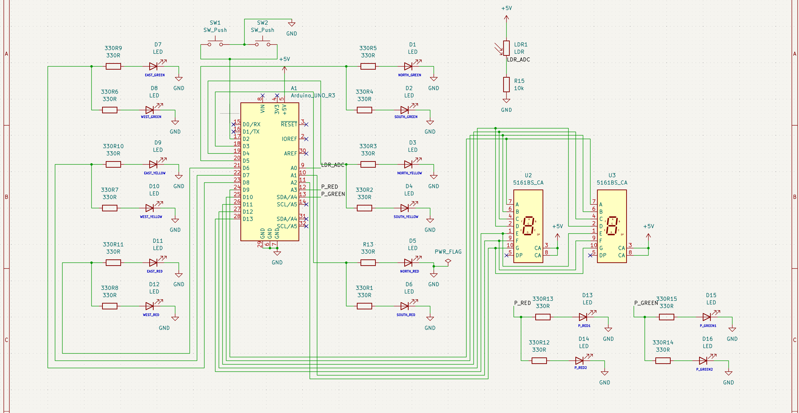

## Project Overview

The **Smart Traffic Junction Controller** is a collaborative project developed using an **Arduino Uno and AVR Assembly language**. It automatically controls traffic lights at a four-way junction, allows pedestrians to cross safely using a push-button and countdown display, and switches to flashing yellow lights at night using an LDR sensor.

The project uses **hardware timers, interrupts, ADC, and GPIO control** to manage traffic signals and pedestrian requests, providing hands-on experience in embedded systems programming and hardware integration.

## Key Features & Technical Implementation

### 1. Automated Traffic Light Control
- Developed an automated traffic signal system for a four-way junction.
- Implemented timed green, yellow, and red light sequences for North-South and East-West traffic.
- Included all-red intervals to ensure safe traffic transitions.

### 2. Hardware Timer Implementation
- Configured **Timer1 in CTC mode** to generate interrupts every 10 ms.
- Used timer interrupts to implement accurate 1-second and 500 ms delays.
- Applied timer-based delays for traffic light sequencing, pedestrian countdowns, and night-mode flashing.

### 3. Interrupt-Based Pedestrian Crossing
- Configured the **INT0 external interrupt** to detect pedestrian push-button presses.
- Implemented a request-handling system that allows the current traffic phase to finish before activating pedestrian crossing.
- Developed a 5-second countdown using two seven-segment displays.
- Added a locking mechanism to prevent repeated crossing requests.

### 4. Automatic Night Mode Using LDR
- Interfaced an **LDR sensor with the ADC** to measure ambient light levels.
- Implemented automatic switching to night mode when low-light conditions are detected.
- Programmed yellow traffic lights to flash at 1 Hz during night mode.
- Added a delay-based checking mechanism to prevent unwanted switching between normal and night modes.

### 5. GPIO & Hardware Interfacing
- Used direct AVR register manipulation to control traffic LEDs, pedestrian signals, and seven-segment displays.
- Configured microcontroller input and output pins for different hardware components.
- Integrated all hardware components with the Arduino Uno using AVR Assembly programming.

Hardware Design

The hardware circuit was designed using KiCad and built around the Arduino Uno (ATmega328P). It integrates traffic signal LEDs, pedestrian push-buttons, seven-segment displays, and an LDR sensor to control the traffic junction.

Circuit Schematic

